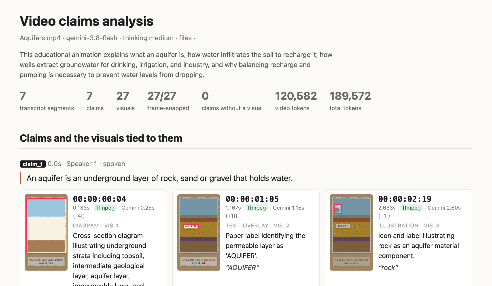
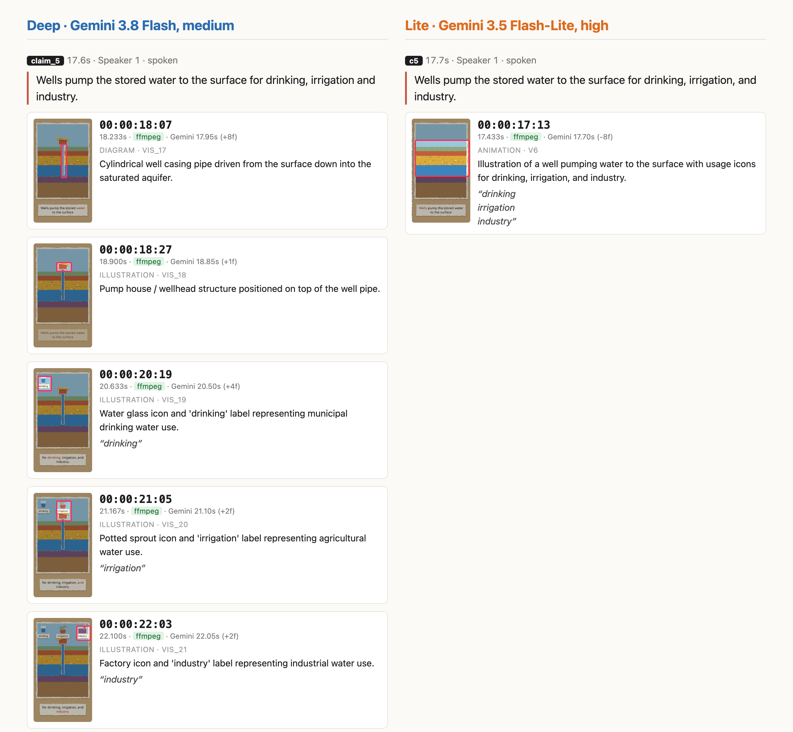
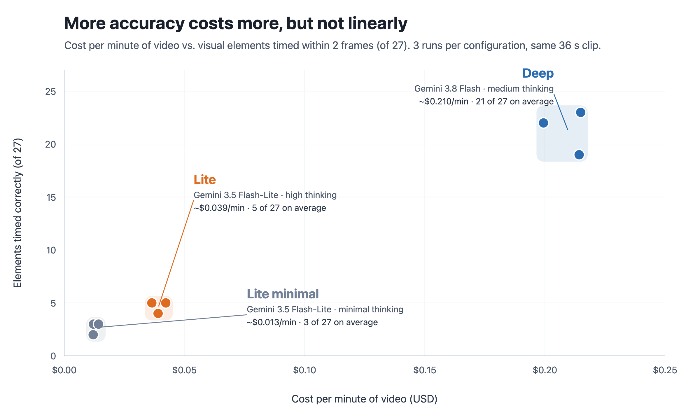

# ClipWitness

**Point Claude Code or Codex at a video. Get back every factual claim it makes, and the exact frame where each
chart or graphic backs it up.**

> Analyze ~/Movies/explainer.mp4 for fact-checking.

You get:

| Output | What's in it |
|---|---|
| `transcript.srt` | Who said what, when |
| Claims | Every checkable statement, spoken or on screen, quoted word for word |
| Visuals | Each chart, map or animation tied to a claim, with a frame-accurate timecode and a still |
| `report.html` | All of the above as one browsable page (optional) |

It records what a video says and shows. It doesn't decide what's true: hand its output to a fact-checker.

Powered by Gemini video understanding. Packaged as a plugin (`video-analysis`) for Claude Code and Codex.

## What you get

**Example input:** a 36-second educational video explaining aquifers. Any local video or YouTube URL works.

### 1. Claims, each with the visuals that show it



- Each claim is quoted word for word.
- Each visual gets a timecode snapped to the exact frame (green `ffmpeg` badge), with Gemini's own guess beside it.
- Each visual has a still with the element boxed, plus any on-screen text.

### 2. Two depths: `deep` and `lite`



| | `lite` (default) | `deep` |
|---|---|---|
| Cost | ~$0.04 per minute of video | ~$0.21 per minute of video |
| Visuals | Groups elements together | Separates every element, each with its own timecode |
| Best for | Claims and on-screen text | Checking the visuals too |

### 3. What `deep` buys you



Three runs of each depth on the aquifers example.

## Requirements (macOS)

- **Python 3.10+** on `PATH`: `brew install python@3.13`
- **ffmpeg**, which snaps each visual to its exact frame: `brew install ffmpeg`. Without it, timecodes are
  Gemini's estimates.
- **A Gemini API key** from [Google AI Studio](https://aistudio.google.com/apikey), exported in the shell that
  starts Claude Code or Codex:

  ```bash
  echo 'export GEMINI_API_KEY="your-key"' >> ~/.zshrc
  ```

  Free-tier keys work for local videos. YouTube URLs need a paid-tier key.

No setup step. On first use the skill installs its own dependencies:

- **Where:** `~/.cache/video-analysis/venv-<hash>`, shared by Claude Code and Codex. Set `VIDEO_ANALYSIS_HOME`
  to move it.
- **How long:** about 20 seconds, once. Needs network access to PyPI.
- **Updates:** a plugin update with new dependencies builds a new `venv-<hash>` beside the old one. Delete old
  `venv-*` folders whenever you like (about 90 MB each).

## Install in Claude Code

To install from a local clone instead, use its path in place of `jorgecolonconsulting/clipwitness`.

**CLI** (also covers the Code tab of the Claude desktop app, which uses the same plugin settings):

```bash
claude plugin marketplace add jorgecolonconsulting/clipwitness
```

```bash
claude plugin install video-analysis@clipwitness
```

Or, inside a session: `/plugin marketplace add jorgecolonconsulting/clipwitness`, then `/plugin install video-analysis@clipwitness`.

**Claude desktop app:**

1. In the sidebar, open **Customize**, then **Plugins**.
2. Click **Add** → **Add marketplace** → **Add from a repository**, enter `jorgecolonconsulting/clipwitness`, and click **Sync**.
3. Find **video-analysis** in the plugin list and click **+** to install it.
4. Use it from the **Code** tab: start a new session, or run `/reload-plugins` in an open one.

Notes:

- The desktop app adds marketplaces only from a Git repository. For a local clone, use the CLI.
- Works in Claude Code (CLI or the desktop Code tab) only, not in Chat or Cowork: it runs Python, ffmpeg and
  your API key on your Mac.

## Install in Codex

Codex reads the same repository through `.agents/plugins/marketplace.json`.

**CLI:**

```bash
codex plugin marketplace add jorgecolonconsulting/clipwitness
```

```bash
codex plugin add video-analysis@clipwitness
```

Or run `codex`, type `/plugins`, open the **ClipWitness** tab, and install **video-analysis**.

**Codex desktop app:** add the marketplace with the first command above (the app and CLI share
`~/.codex/config.toml`), then restart the app. Open **Plugins**, choose the **ClipWitness** marketplace,
open **video-analysis**, and click the **+** (install) button. Start a new thread to use it.

### What Codex needs that Claude Code doesn't

No config changes, but expect an approval prompt:

- **Approve running outside the sandbox.** Codex's sandbox blocks the network and writes outside your
  workspace. The skill needs both (Gemini every run; PyPI and `~/.cache/video-analysis` on first run), so it
  asks. Choose "always allow" to stop future prompts.
- **Using the automatic approval reviewer (`approvals_reviewer`)?** It may refuse because the video is
  uploaded to Google. Say in your prompt that uploading the video to Gemini is OK.
- **Keep one `GEMINI_API_KEY`, in `~/.zshrc`.** Codex runs commands in a snapshot of your interactive shell, so
  that key wins. A mismatch shows up as `Gemini interaction failed (INTERNAL ...)` in Codex only.

## Use it

Ask in plain language:

> Analyze ~/Movies/explainer.mp4 for fact-checking.

- The agent picks the skill, says which depth it will run, and reports claims with their visuals and timecodes.
- It runs `lite` unless you agree to `deep` (about 5x the cost; see [the comparison](#2-two-depths-deep-and-lite)).
- Want a browsable page? Ask for the HTML report.
- To call the skill by name: `/video-analysis:analyze-video` in Claude Code; in Codex, type `@` and pick it.

### Run the script yourself

From a clone of this repository:

```bash
python3 plugins/video-analysis/skills/analyze-video/scripts/analyze_video.py \
  --session-root ~/video-sessions analyze ~/Movies/explainer.mp4 --session explainer-v1
```

It prints the path of `analysis.md`. Beside it: `analysis.json`, `transcript.srt`, `frames/visual-NNN.png`.

Follow-up commands reuse the session:

| Command | Does |
|---|---|
| `refine --session explainer-v1 --prompt '...'` | Re-inspects the video and publishes a new revision |
| `resume` | Collects a timed-out analysis without paying again |
| `status` | Shows the session |
| `cleanup` | Deletes the copies uploaded to Google |

HTML report, same layout every run (generated by code from `analysis.json`):

```bash
python3 plugins/video-analysis/skills/analyze-video/scripts/report_html.py <revision-dir> --serve
```

Privacy and trust:

- Local videos are uploaded to Google's Files API and deleted after 48 hours, or sooner by `cleanup`.
- Gemini's output is evidence to check, not ground truth.

## Troubleshooting

- `Gemini interaction failed (INTERNAL ...)`: a server-side Gemini error, more frequent on free-tier keys. Run
  the same command again with a new session name.
- `Dependency setup failed`: the first run couldn't reach PyPI or write to `~/.cache/video-analysis`. Retry once
  network access is available. In Codex, approve running the command outside the sandbox.
- `Cannot write ~/.cache/video-analysis`: the command ran inside Codex's sandbox. Approve it outside the sandbox.
- `nodename nor servname provided`: no network, same cause in Codex.
- `needs Python 3.10 or newer`: `brew install python@3.13`.

## Development

```bash
python3.13 -m venv .venv && .venv/bin/pip install -r plugins/video-analysis/requirements.lock -r requirements-dev.txt
```

```bash
.venv/bin/python -m pytest tests
```

```bash
claude plugin validate .
```

## License

MIT. See [LICENSE](LICENSE).
